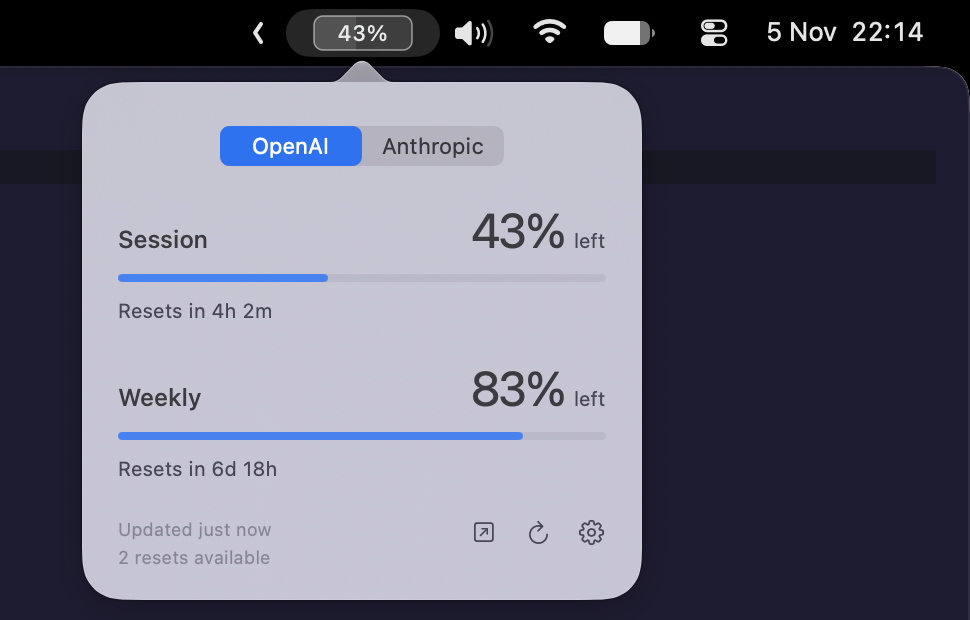

# Tokeyy

A small, native macOS menu bar app for OpenAI and Anthropic usage.



Session and weekly limits, reset times, and optional reset counts. Connect either provider or both.

## Install

Requires macOS 14+ and Xcode with Swift 6.

```sh
./scripts/install.sh
```

Sign in to Codex or Claude Code, then click **Connect** in settings. API keys are not supported.

Settings include appearance, refresh frequency, and launch at login.

## Privacy

Read-only access. No analytics. Tokeyy does not save tokens or usage history.

Uses provider-internal endpoints, which can change.

## Development

Built with SwiftUI and AppKit. No third-party dependencies.

```sh
./scripts/test.sh
```

## License

[MIT](LICENSE). Inspired by [CodexBar](https://github.com/steipete/CodexBar).
